# Bitwarden食用方式
## 安装
[官网](https://bitwarden.com/download/)提供了两种方式：

也可以从GitHub下载APK：

你可以任选一个安装途径。
## 创建账户
1. 打开软件，点击`创建账户`
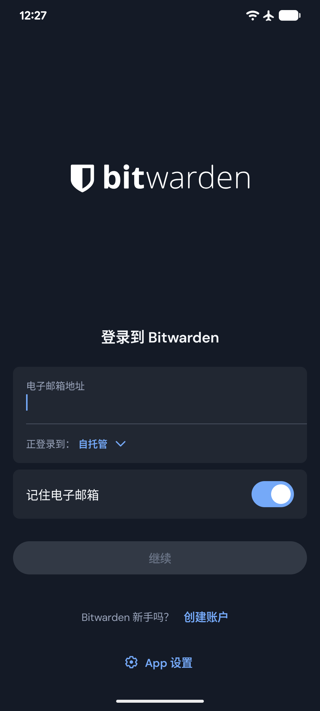
2. 输入邮箱，点击`继续`。
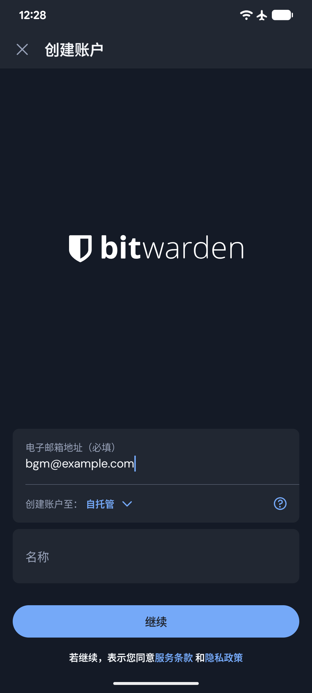
3. 完成所有输入框，点击`下一步`。
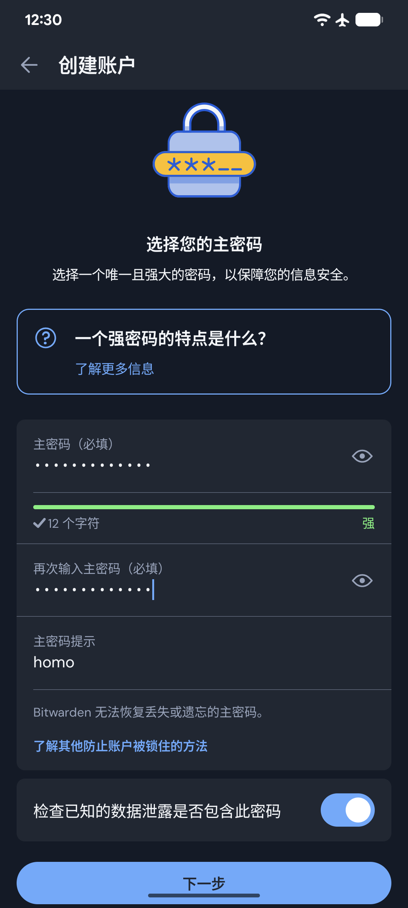
4. 建议开启`使用生物识别解锁`。
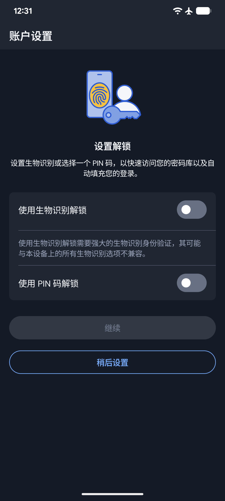
5. 完成生物识别验证
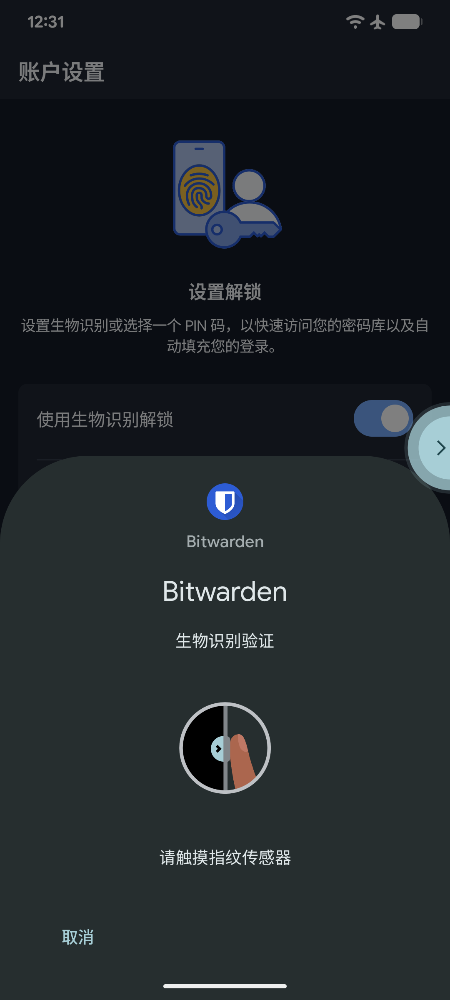
6. 点击`继续`
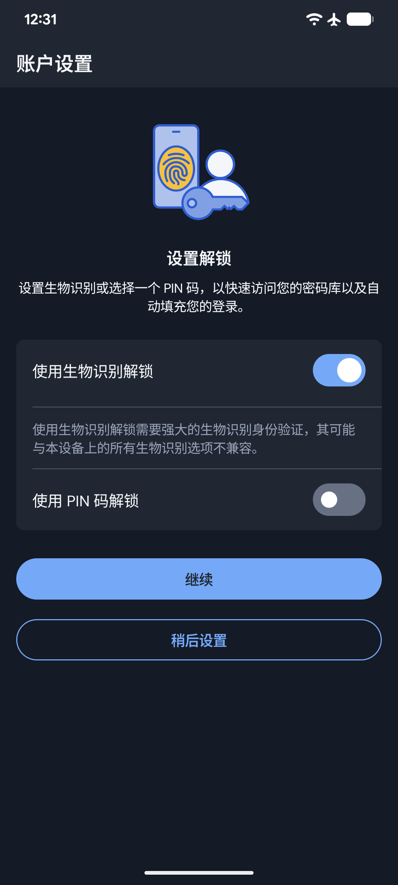
7. 开启`自动填充服务`
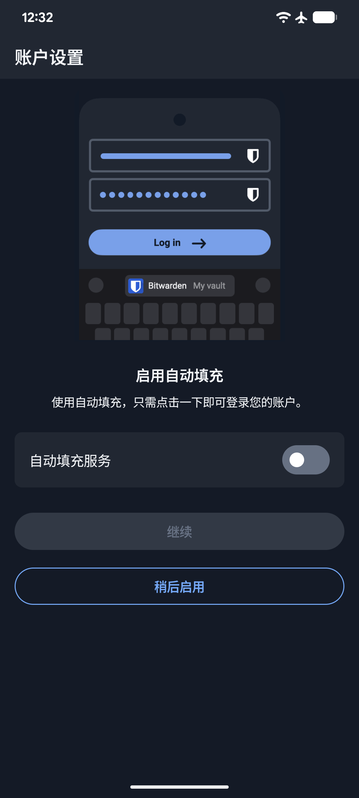
8. 选择`Bitwarden`
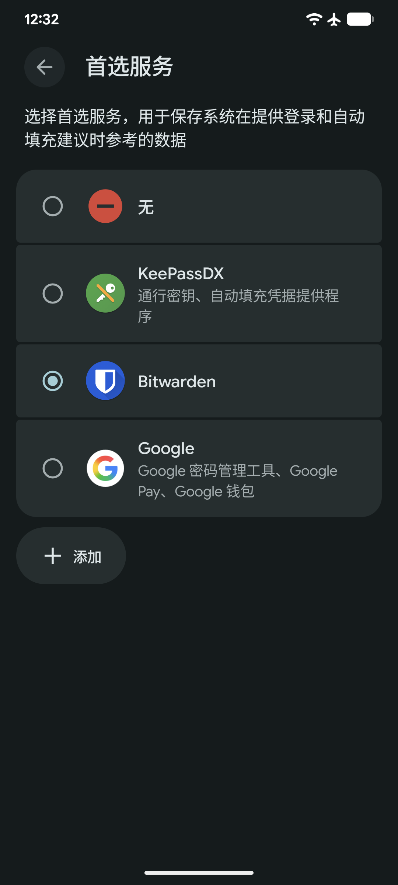
9. 至此创建账户完成
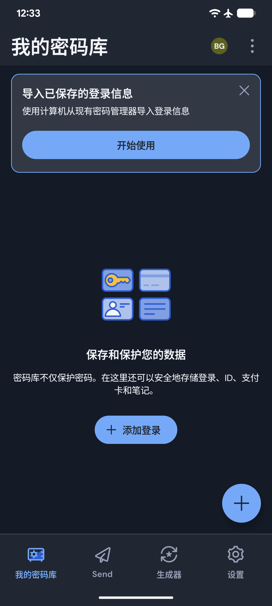
## 注册Passkey
1. 进入[bangumi官网](https://bgm.tv)并登录
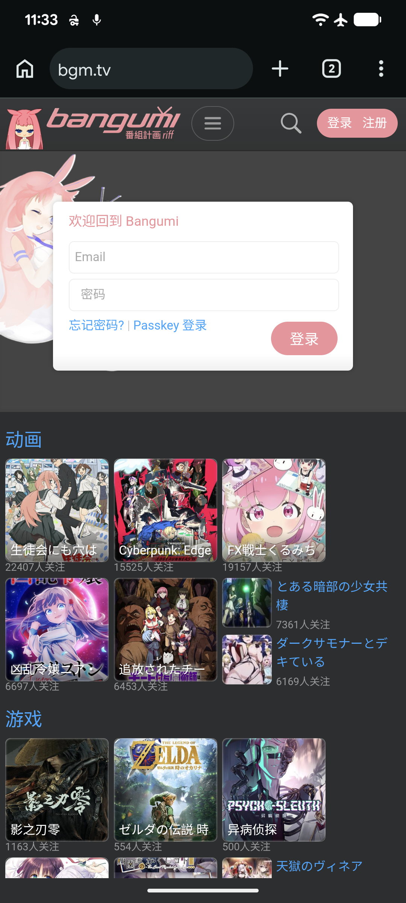
2. 进入[Passkey管理页面](https://bgm.tv/settings/passkeys)，点击添加Passkey
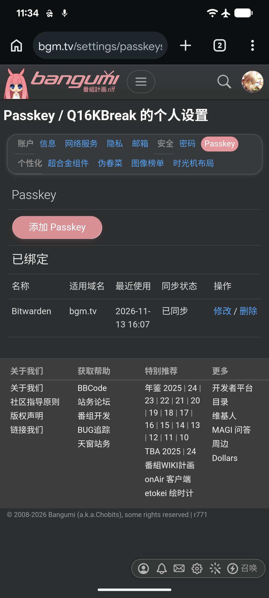
3. 输入密码点击确定
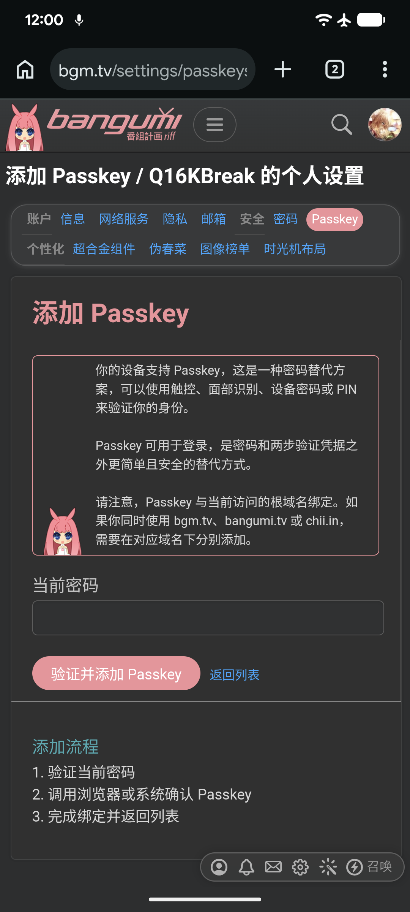
4. 完成用户验证，后跳转到应用界面
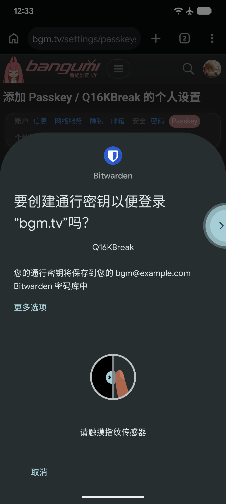
5. 点击右下角`+`号
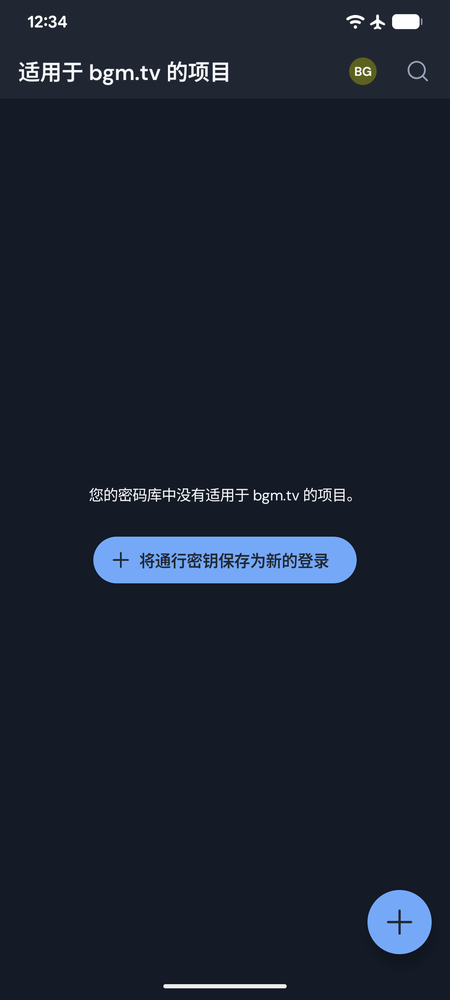
7. 点击右上角`保存`
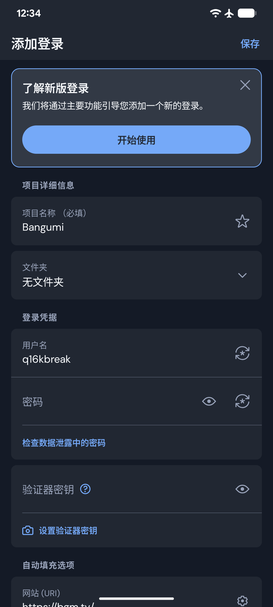
8. 至此注册passkey完成
## 使用Passkey
1. 进入app登录界面，点击passkey登录
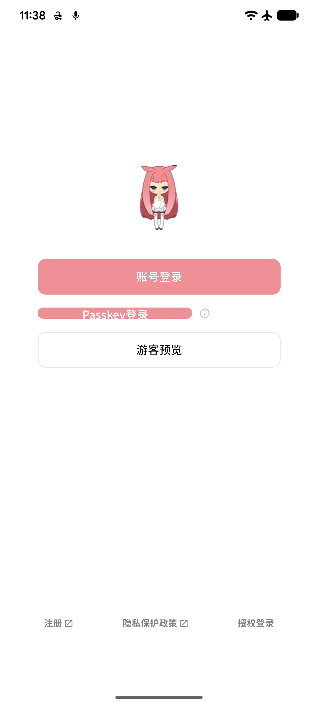
2. 系统弹出窗口，完成用户验证
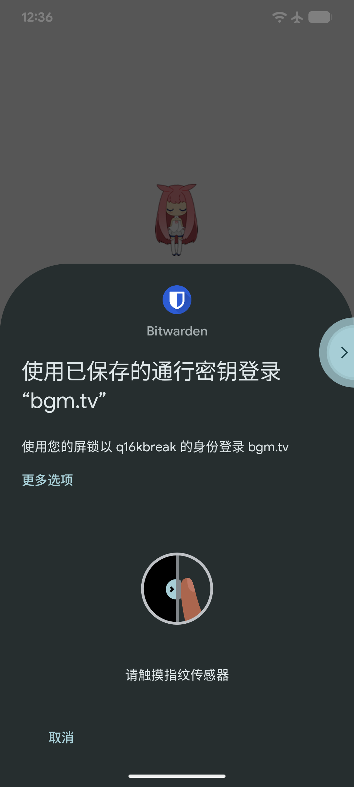
3. 首次使用需要授权特权应用，点击`信任`
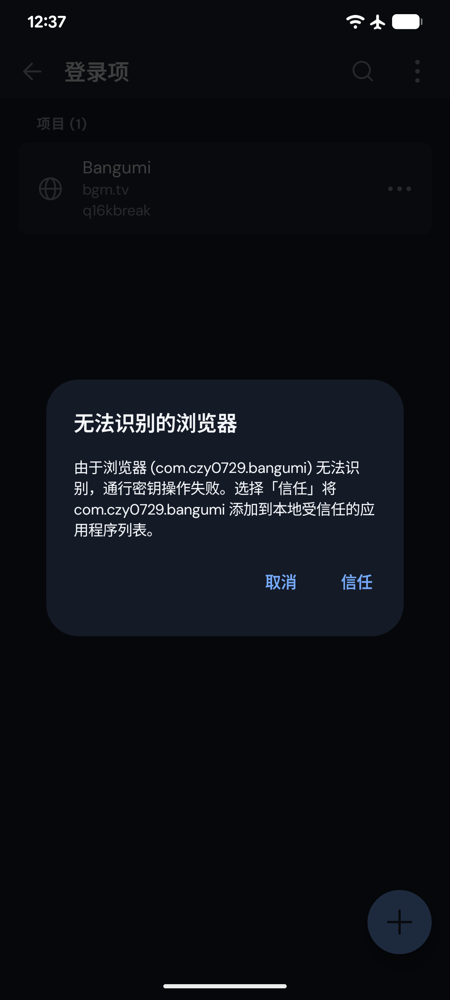
4. 完成登录
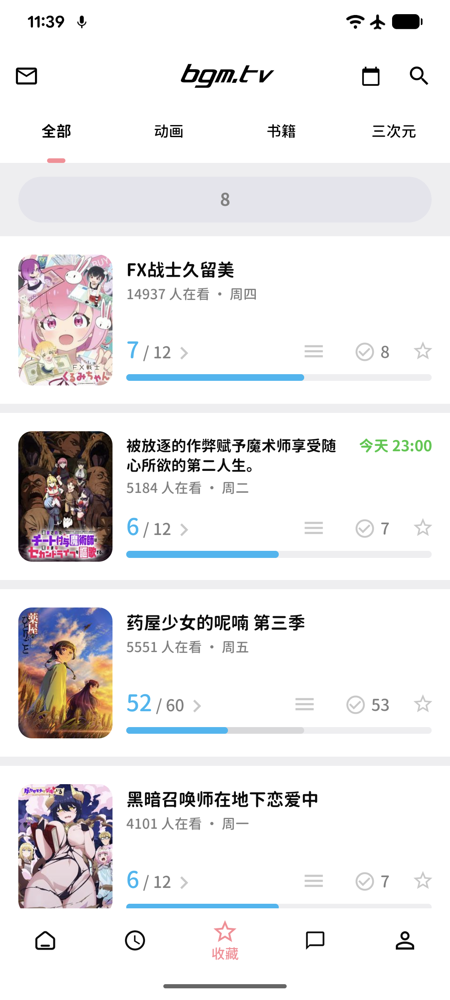